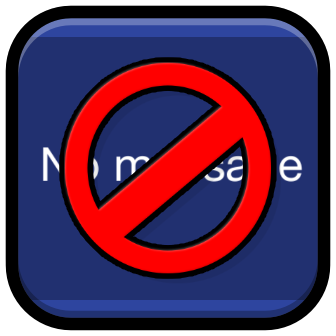

# No Empty Friend Requests
For those who hate empty friend reqs (aka me lol)

> [!IMPORTANT]
> This mod is **discontinued** due to an update to the Geometry Dash servers that makes you **unable to send a message with a friend request** (the request will appear in the other player's profile as not having a message). Therefore this mod now effectively blocks *every single friend request you recieve*, which obviously isn't ideal. Please make sure to disable this mod if you still want to recieve friend requests

> [!WARNING]
> Setting the setting values for "Interval" and "Cooldown" in a low enough value may cause you to get *rate limited*, so be careful!

## Why?
Cuz I get like 10000000 empty friend requests and I don't like leaving them hanging in there so I have to manually decline them myself, and it's very annoying! While some of the issues are me being, well, me (lol), I think this is a more convenient solution to this problem (I mean I can't be the only one, right? Right???)

## License
This mod is licensed under the **MIT License**. More information about it can be found [here](https://choosealicense.com/licenses/mit/).

## Credits
- [PNGWing](https://www.pngwing.com/) for the prohibited sign on the logo
